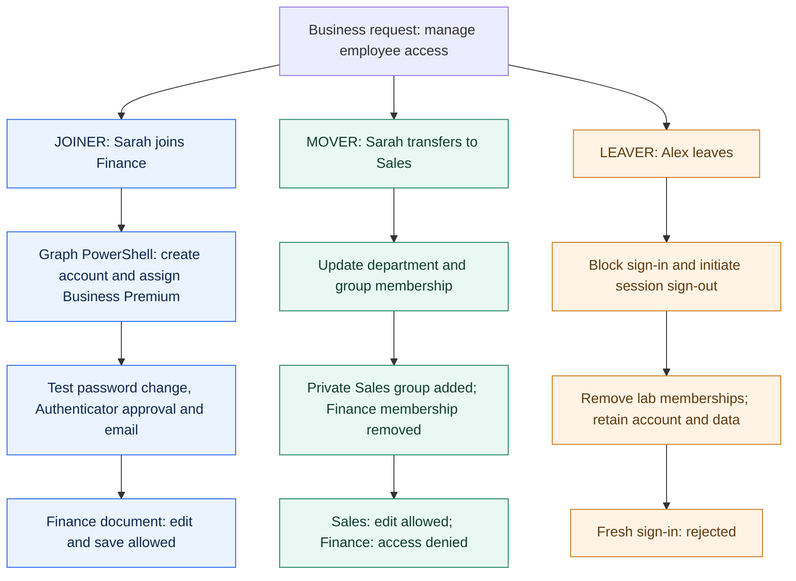
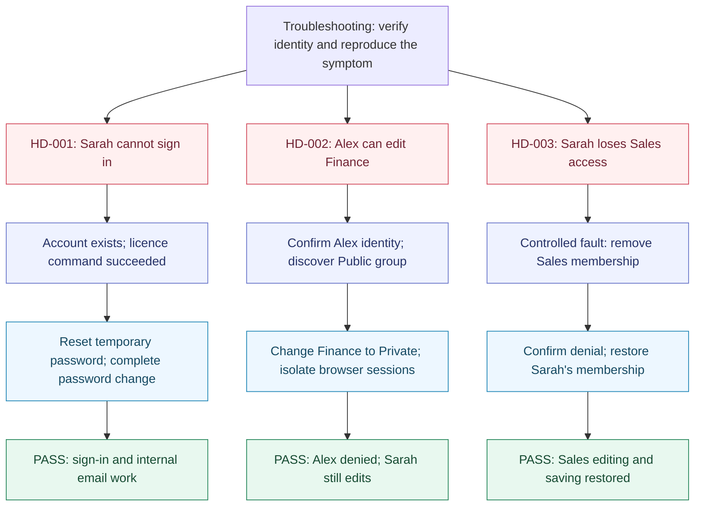

# Olumide Akinseye | IT & Cloud Portfolio

Hands-on projects in **Azure cloud engineering, Microsoft 365 and IT support**.

I bring an engineering and operations background to practical cloud and support labs. This portfolio records what I built, why I chose the approach, how I investigated problems and how I tested the results.

## Explore

| Area | Focus | Progress |
| --- | --- | --- |
| [Azure projects](azure-projects/README.md) | Infrastructure, networking, security and operations | Completed labs and an ongoing platform project |
| [Microsoft 365](microsoft-365/README.md) | Identity, onboarding and access management | Core lifecycle lab completed; limits documented |
| [IT support](it-support/README.md) | Windows Server, Active Directory and troubleshooting | Three support incidents documented; Windows lab planned |

## Selected Azure projects

| Project | What to review |
| --- | --- |
| [Enterprise Azure Network](https://github.com/olumideakinseye77-glitch/azure-enterprise-network) | Hub-and-spoke design, private connectivity and network fault investigation |
| [Identity, Security & Governance](https://github.com/olumideakinseye77-glitch/azure-identity-security-governance) | Least-privilege access, Key Vault and deliberate policy tests |
| [Operations & Incident Lab](https://github.com/olumideakinseye77-glitch/azure-operations-incident-lab) | Linux service failures, Python health checks and verified recovery |

[View all seven Azure projects →](azure-projects/README.md)

## IT support project plan

Three business-scenario projects complement the Azure work: Microsoft 365 employee lifecycle, Windows Server & Active Directory, and help desk troubleshooting.

[View the projects and recommended order](SUPPORT-PROJECTS.md)

## Microsoft 365 support lab

## Skills demonstrated in the Azure labs

Azure networking · Linux · Terraform/HCL · Python · Bash · Git/GitHub · GitHub Actions · Entra ID & RBAC · Azure Policy · Key Vault · Azure Monitor & KQL

## About the evidence

These are independent portfolio labs. Each project documents its implementation, test results and limitations. Completion refers to the recorded lab scope; it does not imply a currently running service. Some deployments were removed after testing to control costs.

Source code and commit history live in the individual Azure repositories. Microsoft 365 and IT support exercises are documented here as they are completed. All published support scenarios use fictional users and redacted evidence.
