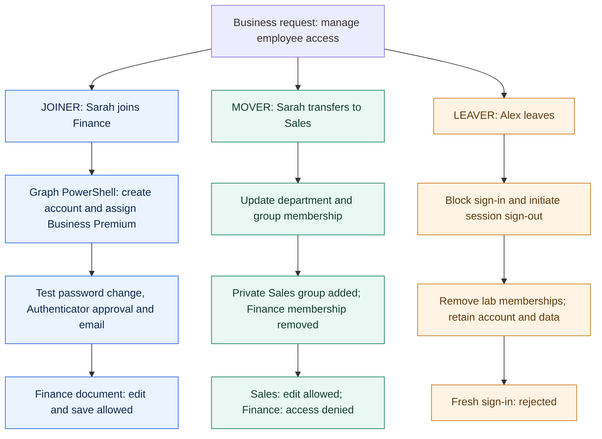
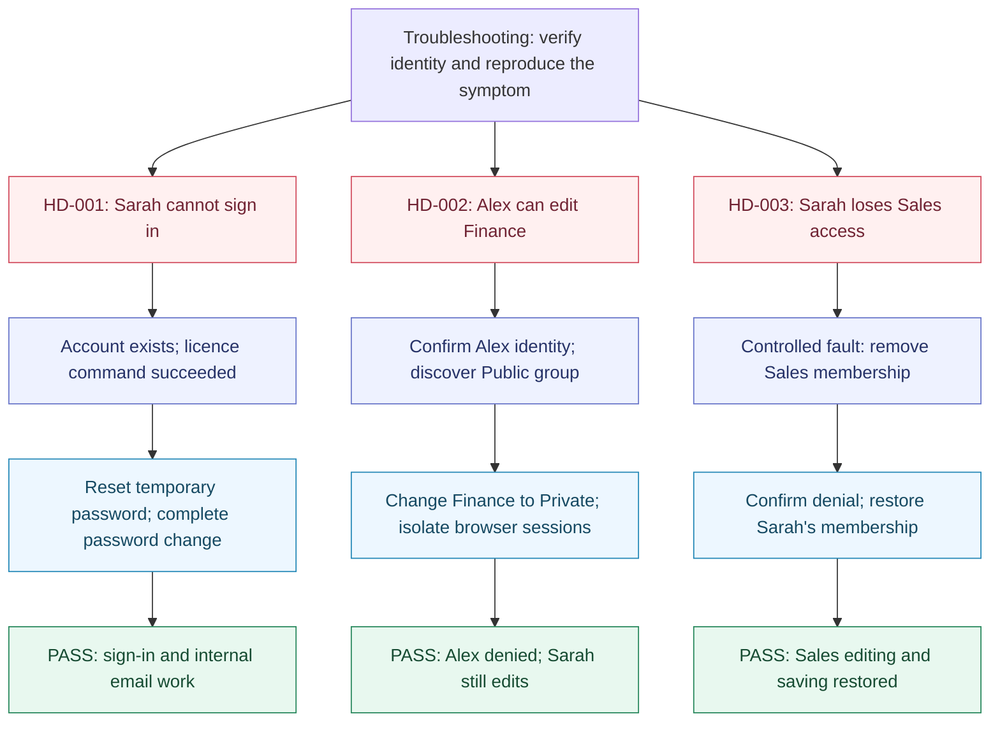

# Microsoft 365 Support Lab — Interview Diagrams

[Project overview](README.md) · [Handover](HANDOVER.md) · [Test evidence](progress.md)

**Olumide Akinseye | Independent Microsoft 365 portfolio lab**

The diagrams show the completed lab journey and the troubleshooting work. They summarise recorded command output and operator-confirmed tests; they do not represent a production environment or an independent tenant audit.

## 1. Employee lifecycle and tested access

Sarah is the joiner and mover. Alex is a separate leaver example.

**Services used:** Microsoft Entra ID for accounts, Microsoft Graph PowerShell for user creation/licensing, Microsoft Authenticator for Sarah's tested approval, Exchange Online/Outlook for email, and Microsoft 365 groups plus SharePoint for department files. Administrative work also used the Microsoft 365 and SharePoint admin centres.

**Final observed state:** Sarah can edit Sales documents and is denied Finance access. Alex's fresh sign-in is blocked. Alex's account, licence and data were retained for lab review.

## 2. Troubleshooting: symptom → evidence → fix → retest

| Incident | What I learned | Full record |
| --- | --- | --- |
| Initial sign-in failure | An account and licence do not prove the employee can sign in. The password reset fixed access; the original cause was not established. | [HD-001](../../it-support/tickets/HD-001-new-starter-sign-in.md) |
| Finance privacy error | Check Public/Private settings and test both authorised and unauthorised users. Browser-session reuse can make the test use the wrong identity. | [HD-002](../../it-support/tickets/HD-002-finance-public-access.md) |
| Lost Sales access | Group membership can determine access. Use a known-working baseline and retest editing after restoring membership. This was a controlled known-cause exercise. | [HD-003](../../it-support/tickets/HD-003-sales-membership-recovery.md) |

## 3. How to explain the project in an interview

“I built a Microsoft 365 lab around a small company's employee lifecycle. I used Microsoft Graph PowerShell to create and license a test user, then tested sign-in, an Authenticator approval and email delivery in both directions.

I created department workspaces and tested permissions from different user accounts. One access test revealed that the Finance group was Public. I corrected it to Private and verified that the Sales user was denied while the Finance user could still edit.

I then moved Sarah from Finance to Sales, tested both her new access and removal of old access, and offboarded Alex by blocking sign-in, initiating session sign-out and removing memberships. Finally, I removed and restored Sales membership to practise diagnosing and resolving missing access. I documented the tests and limitations in GitHub.”

## Evidence boundaries

- Command output supports account creation and licensing. Most browser outcomes are operator-confirmed, without committed screenshots or exported logs.
- Sarah's MFA registration and one challenge passed; the enforcement policy was not independently inspected. Alex's MFA was not tested.
- Private-group settings are not a substitute for auditing direct grants and sharing links. A full sharing-link inventory remains unfinished.
- Fresh blocked sign-in was tested for Alex; existing-session invalidation timing was not measured.
- No mailbox conversion, licence removal, account deletion, Windows lab, Intune or hybrid identity work is represented as completed.
